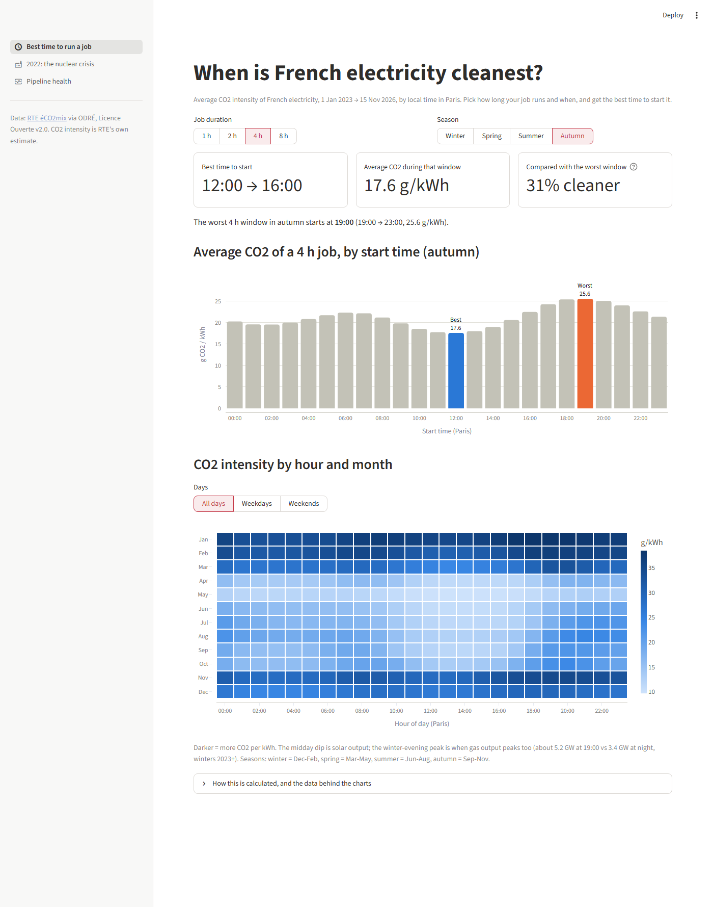
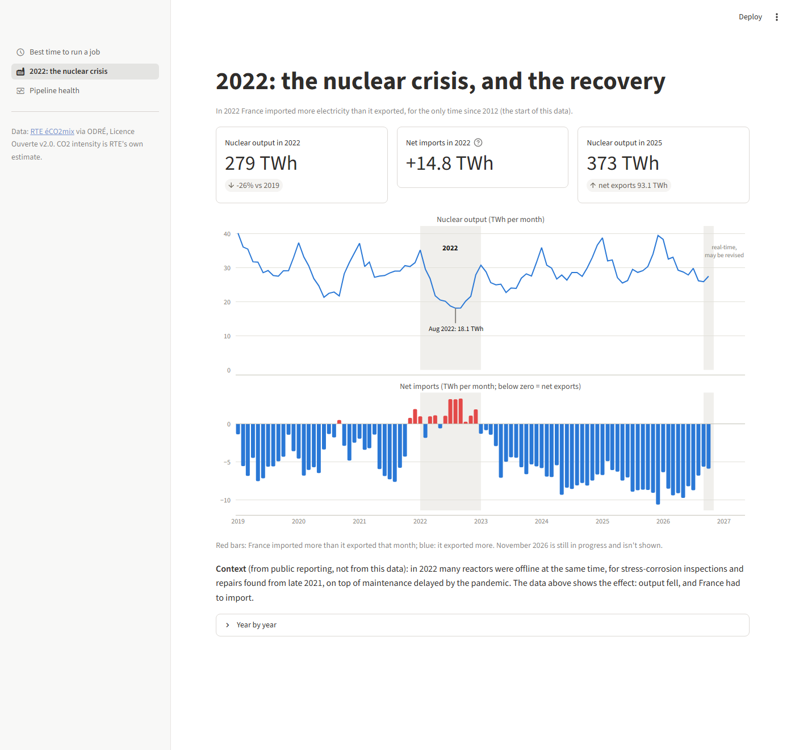
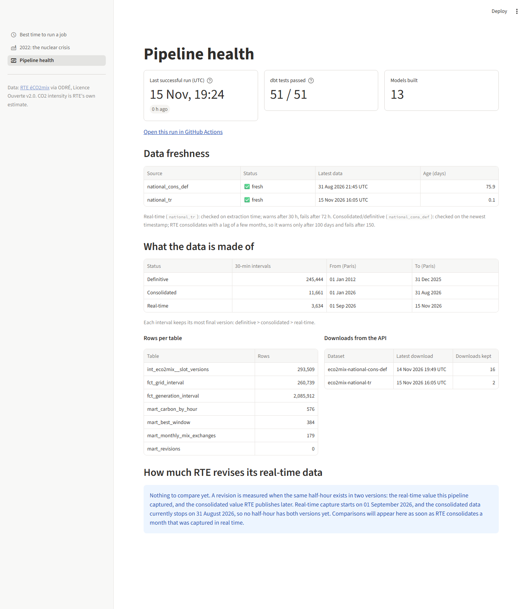
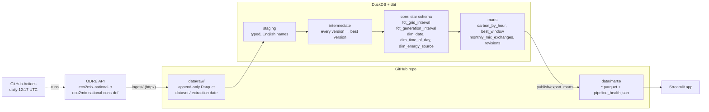

# grid-carbon-pipeline

A daily batch pipeline over France's official electricity data ([RTE éCO2mix](https://odre.opendatasoft.com/explore/dataset/eco2mix-national-cons-def/), via ODRÉ) that answers one question:

> **When is French electricity cleanest, and when should a flexible job (a data-center batch, EV charging) run?**

It also tells a second story, checked against the data: the **2022 nuclear crisis**, when France stopped being a net exporter of electricity, and its recovery after.

Stack: Python 3.12 + `uv`, `httpx`, DuckDB, dbt-core + dbt-duckdb, GitHub Actions, Streamlit + Plotly.

## The answer

**Run it around midday.** From spring to autumn the cleanest 4-hour window starts at **12:00 Paris time**, when solar output peaks. The worst window is the evening, 18:00–20:00, when gas plants cover the demand peak.

| Season | Best 4 h window | Avg CO2 | Worst 4 h window | Avg CO2 | Best is cleaner by |
|---|---|---|---|---|---|
| Summer | 12:00 → 16:00 | 11.5 g/kWh | 20:00 → 00:00 | 21.4 g/kWh | **46%** |
| Autumn | 12:00 → 16:00 | 17.6 g/kWh | 19:00 → 23:00 | 25.6 g/kWh | 31% |
| Spring | 12:00 → 16:00 | 15.2 g/kWh | 19:00 → 23:00 | 20.3 g/kWh | 25% |
| Winter | 01:00 → 05:00 | 30.5 g/kWh | 18:00 → 22:00 | 35.0 g/kWh | 13% |

Winter is the exception: there's too little sun to make a midday dip, so the cleanest time is the night, when demand is lowest. Gas output at 19:00 in winter averages about 5.2 GW, against 3.4 GW at night (winters 2023 onwards).

All figures are averages over 2023 onwards. Earlier years include coal and the 2022 crisis, so they describe a grid that no longer exists. CO2 intensity is RTE's own estimate (`taux_co2`).

French electricity is already very low-carbon (mostly nuclear), so the absolute gain is a few grams per kWh. The *relative* gain is large, and it's free: you only have to move the start time.

**The pipeline follows its own advice.** The daily GitHub Actions job runs at 12:17 UTC (13:17 Paris in winter, 14:17 in summer), inside the cleanest hours this pipeline measured.

### 2022: the nuclear crisis

| | 2019 | 2022 | 2025 |
|---|---|---|---|
| Nuclear output | 379 TWh | **279 TWh (−26%)** | 373 TWh |
| Net exchanges | net exporter: 58.5 TWh | **net importer: 14.8 TWh** | net exporter: 93.1 TWh |

The lowest month was August 2022, at 18.1 TWh of nuclear. The cause comes from outside the data: stress-corrosion cracks found in several reactors, on top of maintenance delayed by the pandemic.

## Dashboard

Three pages, all reading only the committed mart files.

| Best time to run a job | 2022: the nuclear crisis | Pipeline health |
|---|---|---|
|  |  |  |

- **Best time to run a job:** pick a duration (1, 2, 4 or 8 h) and a season. You get the best start time, its average CO2, and how much cleaner it is than the worst. There's also a heatmap of hour × month.
- **2022: the nuclear crisis:** monthly nuclear output and net imports, 2019 to today.
- **Pipeline health:** the last successful run (with a link to it), data freshness, row counts, dbt test results, and revision statistics.

## Architecture



The daily job (`.github/workflows/daily.yml`) does five things in order:

1. Ingest today's data.
2. Commit the raw files.
3. Run `dbt build` (models and tests together).
4. Export the marts.
5. Commit the marts.

The marts are only committed if every test passed, so the dashboard never shows the result of a failed run.

**Grain.** Everything is at 30 minutes (D12 in [`docs/DECISIONS.md`](docs/DECISIONS.md)). The source is nominally 15-min, but the historical data only has real values every 30 minutes.

There are two fact tables:

- **`fct_grid_interval`:** one row per 30-minute interval (consumption, CO2, net exchange, data status). It has 260k rows, from 2012 to today.
- **`fct_generation_interval`:** one row per interval × energy source, with MW generated. It has 2.1M rows.

They have different grains, so they're kept apart: mixing them would duplicate the interval measures 8 times.

## How revisions are handled

RTE publishes each half-hour three times. First as **real-time** data. Then, one to two months later, as **consolidated** data. Finally, in Q2 of the following year, as **definitive** data.

1. **Raw is append-only.** Every download is saved as a new Parquet partition `dataset/extracted_date=YYYY-MM-DD/`, stamped with `_source_dataset`, `_extracted_at` and the record's `nature` (data status). Nothing is ever edited or deleted.
2. **Every version is kept.** `int_eco2mix__slot_versions` holds every version of every half-hour the pipeline ever downloaded.
3. **The most final version wins.** `int_eco2mix__national` keeps one row per half-hour, picked by priority: definitive > consolidated > real-time, then the latest download.
4. **Revisions are measured.** `mart_revisions` compares the real-time value we captured with the consolidated value that replaced it, by metric and by month.

One thing only showed up by looking at the data. The real-time and consolidated datasets **never overlap**: when RTE consolidates a month, its rows leave the real-time dataset. So a revision is only visible if the pipeline saved the real-time version *before* it disappeared. That is why the daily job downloads the whole real-time dataset every day. It's one API call, under 1 MB.

**Current state:**

- Real-time capture started on 1 September 2026.
- The consolidated data currently stops on 31 August 2026.
- So `mart_revisions` is still empty. The dashboard says so instead of drawing an empty chart.
- The first comparisons will appear when RTE consolidates September 2026.

**Idempotency.** The unit of work is *(dataset, UTC extraction date)*. If today's partition already exists, a second run on the same day writes nothing. The marts are deterministic to the last bit: aggregates over floating-point values use an explicit `order by`, because DuckDB's parallel summation order otherwise changes the last digits. `tests/test_idempotency.py` proves it: it builds the marts twice and checks that the two sets of files are identical.

## Data quality and testing

**dbt: 51 tests, run on every build.**

- unique + not_null on every fact grain;
- accepted_values on data status and energy source;
- relationships from facts to dimensions;
- source freshness on both raw datasets (different thresholds, because consolidated data is expected to be months old).

There are also custom tests:

- **CO2 range:** CO2 intensity must be within 0–300 g/kWh.
- **No gaps:** no unexpected gaps in the 30-minute sequence. Daylight-saving days are allowed to have 23 or 25 hours, and a separate test checks every local day has exactly the expected number of half-hours.
- **Energy balance:** consumption ≈ production + pumping + net imports, within 2% (8% for real-time data). This replaced the planned "sum of sources ≈ total" test, because the data has no total-production column to compare against (D16).

**pytest: 15 tests, run by CI on every push.** They cover:

- ingestion against a fake API, including "a second run on the same day writes nothing";
- idempotency;
- the backfill and the cons-def download (only re-downloaded when its fingerprint changes);
- API retries (transient errors only);
- every dashboard page, run headless with Streamlit's `AppTest`.

The dashboard tests check that page 1 shows the same answer as the mart. They also run the health page against a synthetic, non-empty `mart_revisions`, so that code path doesn't run for the first time in production.

## Run it locally

Requires [uv](https://docs.astral.sh/uv/). The raw data is in the repo, so nothing has to be downloaded:

```bash
uv sync --group dashboard
uv run dbt build --project-dir transform --profiles-dir transform
uv run streamlit run dashboard/app.py
```

Optional:

- `uv run python -m ingest.incremental` fetches today's data (a few API calls).
- `uv run python -m publish.export_marts` refreshes the mart files the app reads.
- `uv run --group dashboard pytest` runs the Python tests.

## Trade-offs and limitations

- **Raw data is committed to git.** That's fine at this size (about 260k half-hours since 2012, about 24 MB of Parquet), and it makes the project reproducible with no cloud account. In production it would live in object storage (S3/GCS), and the repo would hold only code (D6).
- **The CO2 figure is RTE's estimate.** It covers electricity *produced* in France, not consumed. The CO2 of imported electricity isn't counted, which matters most in years like 2022, when France imported a lot.
- **National only.** Regional data has no official CO2 field. Adding it would mean choosing emission factors per source, which is an assumption worth its own project.
- **"Best time" is an average profile.** It says when a job is cleanest *on a typical day* of the season, not on a given day. A real scheduler would use a forecast.
- **Revisions can't be shown yet** (see above). The consolidated → definitive revision for 2026 can't be observed until about Q2 2027.
- **GitHub cron is UTC, best-effort, and ignores daylight-saving time.** A missed day is caught up the next day, because each run downloads the whole real-time dataset (D26).

Every non-obvious choice, with the alternatives considered, is in [`docs/DECISIONS.md`](docs/DECISIONS.md) (D1–D30). What the API actually returns, including the surprises, is in [`docs/DATA_NOTES.md`](docs/DATA_NOTES.md).

## Data licence

RTE éCO2mix data via [ODRÉ](https://odre.opendatasoft.com/), under Licence Ouverte v2.0 (Etalab).
